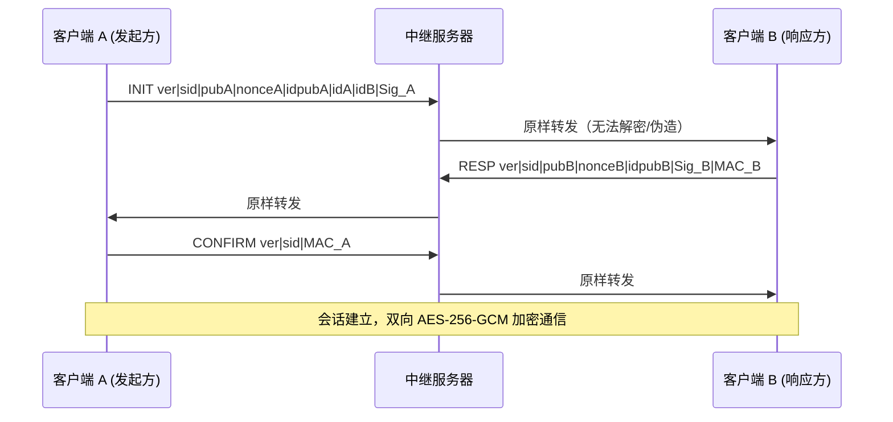

# 基于 ECDHE 的前向保密聊天工具

> 《专业课程设计》— 网络信息安全方向  题目十九

一个用 C++17 实现的端到端加密（E2EE）聊天工具：**每次会话都用 X25519 临时密钥做 ECDHE 密钥交换**，派生独立的会话密钥，并用 AES-256-GCM 加密聊天内容。中继服务器不持有任何密钥，即使服务器被攻破也无法解密历史与实时消息。

---

## 1. 安全设计

### 1.1 威胁模型

| 攻击者能力 | 系统响应 |
|---|---|
| 被动窃听链路（抓包） | 只能看到密文、帧长度和收发关系 |
| 攻破中继服务器 | 服务器无密钥，无法解密；也无法篡改（会破坏 AEAD 认证） |
| 主动中间人（MITM，替换公钥） | 签名 + Finished 校验可阻断“篡改”；**首次见面**需靠安全码核对（见 1.6） |
| 重放/篡改/乱序 | 帧头（会话号 + 序号 + 收发方）作为 AAD 参与认证，序号严格单调 |
| **日后长期主密钥泄露** | 会话密钥只由**临时**私钥派生，历史会话无法被还原（前向保密） |

### 1.2 握手流程（自研 TLS 1.3 风格）



- `pubA / pubB`：**本次会话新生成**的 X25519 临时公钥（32 字节）
- `Sig_A / Sig_B`：Ed25519 **长期身份私钥**对握手报文的签名（只认证、不参与密钥派生）
- `MAC_A / MAC_B`：用 `finished_key` 对握手 transcript 做 HMAC-SHA256，证明双方派生出相同会话密钥

### 1.3 密钥调度

```
Z       = X25519(临时私钥, 对端临时公钥)                  // 每次会话都不同
secret  = HKDF-SHA256(Z, salt = nonceA‖nonceB, "CHAT-v1 ECDHE X25519")
chainI2R= HKDF(secret, "", "chain initiator->responder")   // 方向 1 的链密钥
chainR2I= HKDF(secret, "", "chain responder->initiator")   // 方向 2 的链密钥
finish  = HKDF(secret, "", "finished key")                // 握手确认用
```

**域分离**：收发两个方向使用不同链密钥，避免同一把密钥双向复用。

### 1.4 消息级密钥棘轮

每条消息发送前：

```
msg_key = HKDF(chain, "", "message key")
nonce   = HKDF(chain, "", "message iv")
chain'  = HKDF(chain, "", "chain next")     // 立即丢弃旧 chain
```

由此获得**消息级前向保密**：即使当前链密钥被攻破，也无法还原此前消息的密钥。

### 1.5 三次“前向保密”论证（答辩要点）

1. **握手临时化**：每次会话的 X25519 密钥对都用完即毁（`eph.reset()`），事后无从还原共享秘密；
2. **身份密钥隔离**：长期 Ed25519 私钥只负责签名，从不参与密钥派生 → 主密钥泄露不影响历史会话；
3. **链密钥推进**：消息密钥随棘轮前进并被覆盖，历史消息密钥不可恢复。

### 1.6 身份认证与中间人（MITM）防护

ECDHE 本身只解决“密钥协商”，不解决“对面是谁”。本项目的认证分两层：

1. **签名层（自动）**：Ed25519 长期身份密钥对握手报文签名，任何篡改都会被发现；
2. **身份可信层（人工）**：
   - **TOFU 指纹固定**：首次通信时记录对端身份公钥到 `pins\<本地ID>.log`，之后指纹变化即阻断；
   - **安全码（SAS）**：握手完成后双方由 transcript 派生 6 位数字，显示在状态栏，口头核对即可。

> ⚠️ **必须诚实说明的边界**：身份公钥是随握手报文“自我介绍”的，因此**首次接触时**攻击者若全程在场，可以分别与两端各做一次握手（见第 5.4 节的 MITM 工具），两端都会显示“会话已建立”。此时唯一的破绽是**两端的安全码不同**。
>
> 也就是说：
> - 防“篡改/重放/降级”：✅ 自动完成；
> - 防“首次接触的 MITM”：✅ 但**需要双方核对一次安全码**（与 Signal / WhatsApp 的安全码机制相同）；
> - 若要完全不依赖人工核对，则需引入 PKI/CA 或预置对端公钥。

### 1.7 前向保密与 MITM 的关系

二者正交：PFS 保证“事后拿到主密钥也解不开历史记录”；SAS/指纹保证“当下对面不是冒充者”。两者都具备，才同时抵御“事后解密”与“实时劫持”。

---

## 2. 帧格式

TCP 上每条消息：

```
[ uint32 长度 ][ uint32 目标/来源 ID ][ 载荷 ]
```

载荷首字节为版本，第二字节为类型：

| 类型 | 值 | 长度 | 说明 |
|---|---|---|---|
| `HS_INIT` | 0x01 | 162 | 握手请求 |
| `HS_RESP` | 0x02 | 186 | 握手响应（含签名 + MAC_B） |
| `HS_CONFIRM` | 0x03 | 42 | 握手确认（MAC_A） |
| `DATA` | 0x10 | 18 + 密文 + 16 | `sid|seq|AES-256-GCM(明文, AAD)` |
| `SYSTEM` | 0xFF | — | 服务器提示（如“用户不在线”），明文 |

**AAD** = `ver|type|sid|seq|sender|target`（26 字节）——中继服务器无法在不解密的情况下篡改会话号、序号或收发方。

---

## 3. 目录结构

```
├── CMakeLists.txt
├── Common/
│   ├── crypto_utils.h      # OpenSSL 封装：X25519 / HKDF / AES-GCM / Ed25519
│   ├── protocol.h          # 协议常量、编解码、AAD 构造
│   └── secure_session.h    # 可复用的安全会话（握手 + 记录层 + 安全码）
├── Server/
│   └── server.cpp          # 不可信中继：按 ID 转发，不持密钥
├── ClientGUI/
│   └── ClientGUI.cpp       # Win32 GUI + 会话管理 + 持久化
├── Tests/
│   └── crypto_selftest.cpp # 密码学自测（19 项）
└── Tools/
    ├── mitm_relay.cpp      # MITM 中间人演示工具（教学用）
    ├── mitm_demo.ps1       # MITM 演示 + 截图自动化
    └── smoke_test.ps1      # 端到端功能测试
```

> 说明：`ClientGUI/ClientGUI.vcxproj`、`Server/Server.vcxproj` 与各自 `x64/` 目录是早期的 Visual Studio 手写工程，**已不再使用**，请统一用 CMake 构建，避免编译到旧代码。

---

## 4. 构建与运行

依赖：Visual Studio 2022、CMake ≥ 3.20、vcpkg（`openssl`、`boost-asio`）。

```bash
vcpkg install openssl:x64-windows boost-asio:x64-windows
```

用 VS Code 的 CMake Tools 直接构建，或：

```bash
cmake -B build -DCMAKE_TOOLCHAIN_FILE=<vcpkg>/scripts/buildsystems/vcpkg.cmake
cmake --build build --config Debug
```

运行：

1. 启动 `build/Debug/Server_App.exe`（监听 9000）；
2. 启动一个或多个 `build/Debug/ClientGUI_App.exe`；
3. 窗口标题会显示自己分配到的 ID；在左侧会话列表里点选联系人，或在“收件人 ID”里填对方 ID，输入消息回车发送。

界面说明：

| 区域 | 作用 |
|---|---|
| 左侧会话列表 | 按对端用户分组，未读消息显示红点 `●`；点击切换会话 |
| 中间聊天区 | 只显示聊天内容，格式为 `[时:分] 我: …` / `[时:分] 用户N: …` |
| 底部输入行 | 收件人 ID + 消息输入框 + 发送按钮（Enter 发送） |
| 底部状态栏 | 连接状态、握手进度、会话密钥指纹、错误提示（红色） |

握手、指纹、断线重连等过程信息全部只出现在状态栏，不会污染聊天记录。例如建立会话后状态栏显示：

```
与用户 2 的安全会话已建立 · 密钥指纹 8b1e07a4
```

发送给不在线用户时，聊天区会出现 `⚠ 用户 N 不在线，1 条消息未送达`，状态栏同时变红提示。

### 数据存放位置

| 文件 | 说明 |
|---|---|
| `%APPDATA%\ECDHE_Chat\identity.pem` | 长期身份私钥（Ed25519），重启后保持不变 |
| `%APPDATA%\ECDHE_Chat\chats\<本地ID>\<对端ID>.log` | 按会话分文件的聊天记录，重启自动重载并自动选中最近会话 |

路径均使用宽字符 API，支持中文用户名。聊天记录按“本地实例”分目录存放，同一台机器上同时运行两个客户端也不会互相串记录。

---

## 5. 验证

### 5.1 密码学自测（19 项）

```bash
build/Debug/CryptoTest.exe
```

覆盖：Ed25519 签名与验签、PEM 持久化、X25519 一致性、**每次握手共享秘密不同**、HKDF 域分离、GCM 篡改检测（AAD/密文/密钥）、棘轮同步与历史密钥不可恢复。

### 5.2 端到端自动化测试

```powershell
powershell -NoProfile -ExecutionPolicy Bypass -File Tools\smoke_test.ps1
```

脚本会启动 1 个服务器 + 2 个客户端，驱动界面互发消息，并校验双方都能解密显示。典型服务器日志：

```
[中继] 1 -> 2 转发 162 字节（内容不可解密）   ← HS_INIT
[中继] 2 -> 1 转发 186 字节（内容不可解密）   ← HS_RESP
[中继] 1 -> 2 转发 42  字节（内容不可解密）   ← HS_CONFIRM
[中继] 1 -> 2 转发 53  字节（内容不可解密）   ← 加密消息
[中继] 2 -> 1 转发 51  字节（内容不可解密）   ← 加密消息
```

### 5.3 前向保密演示

1. 抓包可见两次连接的 32 字节公钥完全不同，密文完全不同；
2. 删除 `identity.pem`（模拟“主密钥泄露”）后重启，历史密文依旧无法解密；
3. 每次握手打印的“会话密钥指纹”互不相同。

### 5.4 MITM 中间人演示（拦截式）

```powershell
powershell -NoProfile -ExecutionPolicy Bypass -File Tools\mitm_demo.ps1
```

脚本会：启动 `MitmRelay.exe`（冒充服务器监听 9000）→ 启动两个客户端 → 自动互发消息 → 截图 → 打印攻击者视角。

典型输出（**攻击成功**，但安全码暴露了它）：

```
[MITM] 已冒充用户 2 接受用户 1 的握手
[MITM] 已冒充用户 1 向用户 2 发起握手
[MITM] 欺骗成功：用户 1 与用户 2 都显示“加密会话已建立”
[MITM] 但两端的安全码不同：
[MITM]   用户 1 看到 079293   用户 2 看到 144243
[截获] 1 -> 2 明文: card-password-is-123456
[抓包]   密文 39 字节，前 16 字节 8f1e95664a5770afdf1a0dbfebec1aa5
```

结论：
- **不加核对**：中间人可完整解密、篡改、转发，双方毫无察觉；
- **核对安全码**：两端数字必然不同 → 当场发现被劫持。

> 演示结束后请关闭 `MitmRelay`，重新启动正常的 `Server_App`，否则客户端会继续连到中间人。
> 若之前被中间人污染过 `pins\*.log`，请删除该目录后重试（删指纹目录 = 重置信任）。

---

## 6. 已知限制

- 客户端 ID 由服务器按接入顺序分配，无登录体系；对端身份的信任采用**本次运行内 TOFU**（首次见面即固定指纹），生产环境应做持久化 + 指纹核对；
- 聊天记录按“服务器分配的本地 ID”分目录，若服务器重启后客户端拿到的 ID 与上次不同，历史记录会归入新的目录；
- 一条 TCP 连接是单一有序流，若丢帧（如对端不在线）会导致棘轮失步，此时会话自动作废、下次发送时重新握手；
- 聊天记录以明文保存在本地（不属于传输层威胁模型），如需本地加密可后续扩展；
- 同一台机器上多个客户端共用同一 `identity.pem`（同一安装实例），部署到多机时天然独立。
