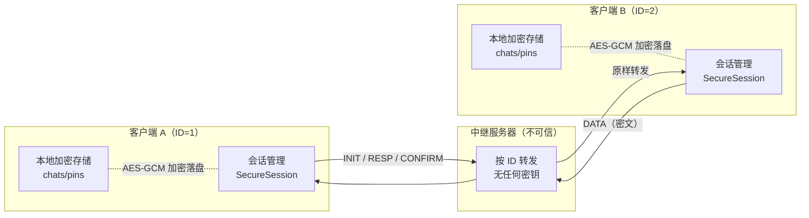
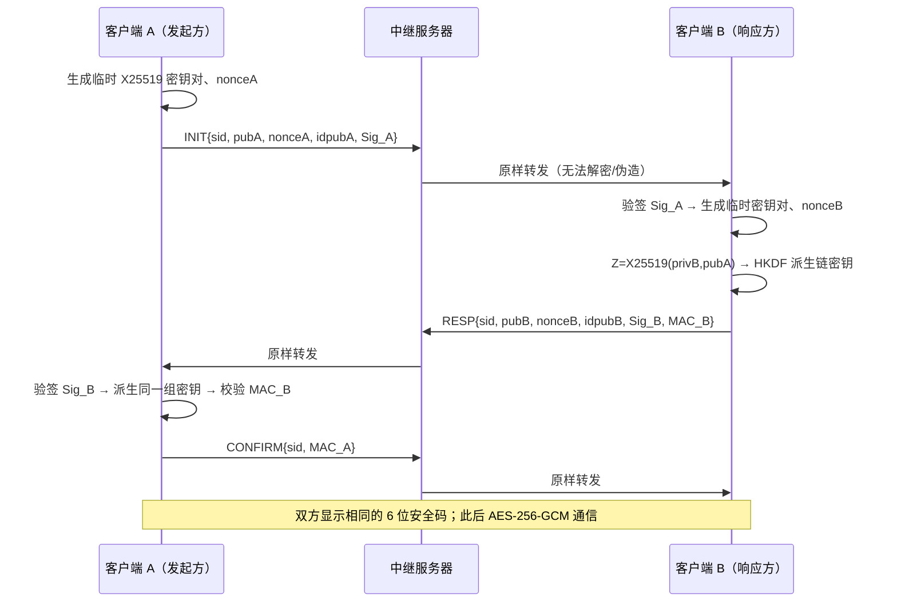
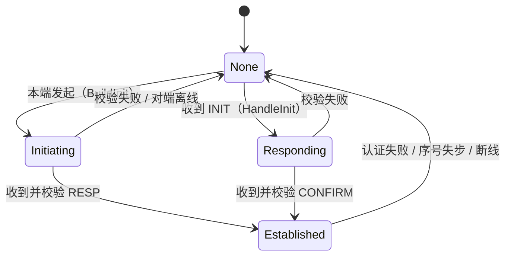
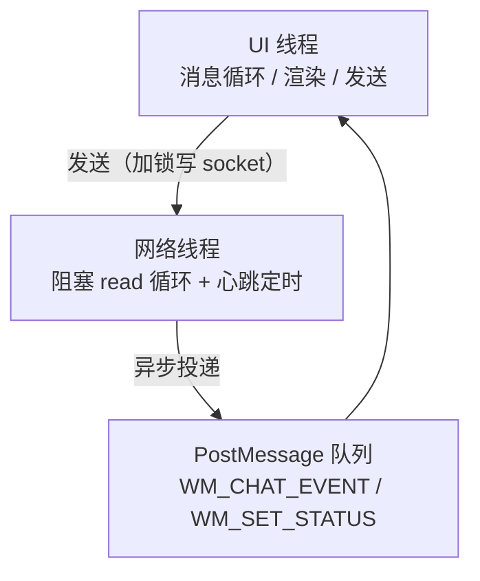

# 基于 ECDHE 的前向保密聊天工具 —— 课程设计报告

> 题目十九：基于 ECDHE 的前向保密的聊天工具的实现
> 方向：网络信息安全
> 实现语言：C++17 ｜ 网络库：Boost.Asio ｜ 密码学库：OpenSSL 3.x ｜ 构建：CMake + vcpkg

---

## 摘要

本课题实现了一个具备**前向保密（Forward Secrecy, FS）**能力的端到端加密（E2EE）即时通讯工具。系统以椭圆曲线迪菲-赫尔曼临时密钥交换（ECDHE / X25519）为核心，每次会话都生成独立的一次性会话密钥，并通过 HKDF-SHA256 派生双向链密钥；记录层采用 AES-256-GCM 认证加密，帧头作为附加认证数据（AAD）参与完整性校验；在此基础上叠加**消息级密钥棘轮**（每条消息密钥用后即弃）与**周期性 DH 棘轮**（每 8 条消息轮换一次 X25519 密钥，旧私钥即时销毁），同时具备前向保密与后向恢复；身份层使用 Ed25519 长期签名密钥，并以 **6 位安全码（SAS）** 与持久化指纹固定抵御中间人攻击。

中继服务器被设计为**不可信中继**：它只按目标 ID 转发密文，从不持有任何会话密钥。为验证这一安全属性，本项目额外实现了一个**可运行的中间人攻击工具**，实测可以在双方界面均显示"会话已建立"的情况下截获并打印明文，同时暴露出两端安全码不一致这一唯一破绽，从而定量地证明了"安全码核对"的必要性。

**关键词**：前向保密；ECDHE；X25519；HKDF；AES-GCM；Ed25519；端到端加密；中间人攻击；密钥棘轮

---

## 1 课题背景与需求分析

### 1.1 前向保密的由来与含义

前向保密（Forward Secrecy，亦称完美前向保密 PFS）由 Christoph Günther 于 1989 年提出，指**长期主密钥的泄露不会导致历史会话密钥泄露**这一安全属性。其直观含义是：

> 攻击者今天拿到了服务器的长期私钥，也无法解密昨天抓到的流量。

在传统 RSA 密钥交换中，会话密钥由服务器长期私钥加密传输，一旦长期私钥泄露，历史流量可被批量解密（"先存后解"攻击）。ECDHE 通过**每次会话都使用临时密钥对**消除了这一关联：长期密钥只用于身份认证，不参与会话密钥生成。

### 1.2 威胁模型

| 攻击者能力 | 说明 | 本系统的设计响应 |
|---|---|---|
| 被动窃听 | 抓包、链路镜像 | 全程 AEAD 加密，攻击者只能得到密文与长度 |
| 攻破中继服务器 | 服务器被完全控制 | 服务器不持有任何密钥，无法解密；篡改会破坏 AAD 认证 |
| 主动中间人（MITM） | 替换握手公钥、双向转发 | 签名 + Finished 校验阻断篡改；首次接触靠安全码核对 |
| 重放 / 篡改 / 乱序 | 修改传输中的帧 | 序号严格单调 + 帧头作为 AAD 参与认证 |
| 事后获取长期密钥 | 拿到 identity.pem | 会话密钥只由临时私钥派生，历史不可还原（前向保密） |
| 本机文件被拷走 | 硬盘/文件被复制 | 身份私钥 DPAPI 加密；聊天记录 AES-GCM 加密；换账户不可解密 |
| 进程崩溃 / 断网 | 异常退出 | 心跳 15 s 判超时并自动重连；服务器 60 s 回收僵尸连接 |

### 1.3 需求分析

**功能需求**

1. 多客户端同时在线，按 ID 点对点通信；
2. 消息端到端加密，服务器不可解密；
3. 会话列表、聊天记录持久化与重启重载；
4. 断线自动重连、离线提示、失败反馈；
5. 可验证的对端身份（安全码 / 指纹）。

**非功能需求**

| 类别 | 指标 |
|---|---|
| 安全 | 机密性、完整性、前向保密、抗重放、抗 MITM（配合安全码） |
| 性能 | 单次握手在局域网内 < 10 ms；AES-GCM 吞吐达到百 MB/s 级 |
| 可用性 | 断网 15 s 内发现并自动恢复 |
| 可维护性 | 密码学层与网络层解耦，协议实现可被测试工具复用 |

---

## 2 相关理论与技术选型

### 2.1 ECDHE 与 X25519

ECDHE = 椭圆曲线迪菲-赫尔曼（临时密钥）。双方各自生成一次性密钥对 $(a, A=aG)$、$(b, B=bG)$，交换公开参数后计算共享秘密：

$$Z = aB = bA = abG$$

本项目选用 **X25519**（Curve25519 的 DH 变体）：密钥固定 32 字节、常数时间实现、无专利与参数选择陷阱，是 TLS 1.3 与 Signal 的默认曲线。

**为什么不用 RSA 密钥交换**：RSA-KEX 无前向保密；且密钥与消息长度绑定，效率与安全性都不如 ECDHE。

### 2.2 HKDF（RFC 5869）

X25519 的输出虽然接近均匀，但直接当对称密钥使用是不规范的。HKDF 提供两步：

```
PRK  = HMAC-SHA256(salt, IKM)          // Extract：把共享秘密"条件化"
OKM  = HMAC-SHA256(PRK, info || 0x01)  // Expand：按用途派生任意长度
```

本项目用 `info` 实现**域分离**：同一份共享秘密派生出"发起方→响应方链密钥"、"响应方→发起方链密钥"、"Finished 密钥"三把互不相同的密钥，避免密钥复用。

### 2.3 AEAD 与 AES-256-GCM

GCM 同时提供机密性与完整性，一次运算产出密文与 16 字节认证标签（Tag）。其关键特性是支持**附加认证数据（AAD）**：AAD 不被加密，但参与 Tag 计算。

本项目把帧头（版本、类型、会话号、序号、发送方、接收方）作为 AAD，使得：

- 服务器若修改收发方 ID → Tag 校验失败；
- 攻击者若重排消息 → 序号变化 → Tag 校验失败。

### 2.4 Ed25519 数字签名

Ed25519 用于**身份认证**：用长期私钥对握手报文签名，对端用公钥验签。它只做认证，**不参与会话密钥派生**——这正是前向保密成立的前提。

### 2.5 前向保密与密钥棘轮

本项目在两个层面实现前向保密：

| 层面 | 机制 | 效果 |
|---|---|---|
| 会话级 | 每次握手生成全新 X25519 临时密钥对，派生完成后立即 `reset()` 销毁 | 会话密钥与长期密钥无关联 |
| 消息级 | 链式棘轮：`msg_key = HKDF(chain, "message key")`，随后 `chain = HKDF(chain, "chain next")` 并覆盖旧值 | 当前链密钥泄露也无法还原历史消息密钥 |

**DH 棘轮（后向恢复）**：每发送 8 条消息，发动方生成新的 X25519 密钥对，用**旧链**加密一条 `REKEY{新公钥}`（控制帧），随后双方计算

```
root' = HKDF(salt = root, ikm = DH(发方新私钥, 收方当前公钥))
chainI2R' = HKDF(root', "ratchet chain initiator->responder")
chainR2I' = HKDF(root', "ratchet chain responder->initiator")
```

并重建双向链，发方旧私钥被覆盖销毁。若攻击者在 T 时刻窃取了某一方的棘轮私钥，受害方下次轮换后就无法继续推导新密钥。

> 与 Signal 双棘轮的差异：本项目采用**周期性**轮换，而非每条消息携带 DH 头；因依赖 TCP 有序且不处理乱序，故不需要 skipped-key 缓存。

### 2.6 安全码（SAS）

ECDHE 只解决"密钥协商"，不解决"对面是谁"。本系统采用与 Signal / WhatsApp 相同的信息论方案：

```
SAS = (SHA256(transcript_hash || "SAS") 的前 4 字节 mod 1,000,000) → 6 位数字
```

握手双方对同一 transcript（INIT + RESP 全部字节）计算，正常情况下必然相同；若中间人插入了两段独立握手，两端 transcript 不同，安全码必然不同——**口头核对一次即可发现劫持**。

### 2.7 与 TLS 1.3 / Signal 的对比

| 特性 | 本系统 | TLS 1.3 | Signal（X3DH + Double Ratchet） |
|---|---|---|---|
| 密钥交换 | X25519 ECDHE | X25519 / P-256 ECDHE | X3DH（多重 DH） |
| 身份认证 | Ed25519 签名 + SAS | 证书链（PKI） | 长期身份密钥 + 安全码 |
| 密钥派生 | HKDF-SHA256 | HKDF（多级） | HKDF（多级） |
| 记录层 | AES-256-GCM + AAD | AEAD | AEAD |
| 前向保密 | ✅ 会话级 + 消息级 | ✅ 会话级 | ✅ 会话级 + 消息级 |
| 后向恢复 | ✅ 周期性 DH 棘轮 | ✅ KeyUpdate | ✅ DH 棘轮 |
| 信任根 | 安全码人工核对 | CA 体系 | 安全码 / 指纹 |
| 元数据保护 | ❌ | 部分（ESNI 等） | Seal sender（部分） |

**结论**：本系统在密码学结构上与 TLS 1.3 高度同构，认证模型上更接近 Signal（无 CA，靠安全码），差异点在于缺少后向恢复与元数据保护。

### 2.8 技术栈

| 组件 | 选择 | 理由 |
|---|---|---|
| 语言 | C++17 | 课程要求；`std::filesystem`、`std::optional` 等便利 |
| 网络 | Boost.Asio | 跨平台、成熟的同步/异步 I/O |
| 密码学 | OpenSSL 3.x（EVP） | 提供 X25519 / Ed25519 / HKDF / GCM 全套算法 |
| GUI | Win32 API | 无需第三方框架，便于展示"手写实现" |
| 构建 | CMake + vcpkg | 依赖管理自动化，避免手工配置 include/lib |

---

## 3 系统设计

### 3.1 总体架构



服务器承担三个职责，**全部不含密码学操作**：

1. 连接管理：分配递增 ID；
2. 路由：按目标 ID 转发帧；
3. 心跳：响应 PING，回收超时连接。

### 3.2 通信帧格式

TCP 上每条消息统一为：

```
+------------+------------------+---------------------------+
| u32 长度    | u32 目标/源 ID    | payload（长度 - 4 字节）    |
+------------+------------------+---------------------------+
```

payload 前两字节为 `[版本][类型]`：

| 类型 | 值 | 长度（字节） | 说明 |
|---|---|---|---|
| HS_INIT | 0x01 | 162 | 握手请求 |
| HS_RESP | 0x02 | 186 | 握手响应（含签名 + MAC_B） |
| HS_CONFIRM | 0x03 | 42 | 握手确认（MAC_A） |
| REKEY | 0x04 | 66 | DH 棘轮轮换（加密传输，载荷为 32 字节新公钥） |
| DATA | 0x10 | 18 + 密文 + 16 | 加密聊天数据 |
| PING | 0x20 | 2 | 心跳（目标 ID = 0，发给服务器） |
| PONG | 0x21 | 2 | 心跳应答 |
| SYSTEM | 0xFF | 6 + 文本 | 服务器提示（如"用户不在线"） |

**各字段布局**

```
HS_INIT : ver(1) type(1) sid(8) pubA(32) nonceA(16) idpubA(32) idA(4) idB(4) sig(64)
HS_RESP : ver(1) type(1) sid(8) pubB(32) nonceB(16) idpubB(32) sigB(64) macB(32)
HS_CONFIRM: ver(1) type(1) sid(8) macA(32)
DATA    : ver(1) type(1) sid(8) seq(8) ciphertext||tag(16)
```

### 3.3 握手协议



**签名覆盖范围（防篡改的关键）**

| 签名 | 覆盖内容 |
|---|---|
| Sig_A | 版本、类型、sid、pubA、nonceA、idpubA、idA、idB |
| Sig_B | RESP 前 90 字节 + **Sig_A**（把 B 的响应绑定到 A 的本次请求） |

**Finished 校验**

```
th   = SHA256(INIT || RESP_core)          // RESP_core = RESP 去掉 macB 的 154 字节
MAC_B = HMAC(finished_key, th || "B")
MAC_A = HMAC(finished_key, th || "A")
```

MAC 的作用不是身份认证（那由签名完成），而是**密钥确认**：证明双方派生出完全相同的会话密钥。

### 3.4 密钥调度

```
Z        = X25519(临时私钥, 对端临时公钥)                     // 32 B
salt     = nonceA ‖ nonceB                                    // 32 B
secret   = HKDF-SHA256(Z, salt, "CHAT-v1 ECDHE X25519", 32)
chainI2R = HKDF(secret, "", "chain initiator->responder")     // 方向 1
chainR2I = HKDF(secret, "", "chain responder->initiator")     // 方向 2
finished = HKDF(secret, "", "finished key")                   // 握手确认
```

**设计要点**

1. `salt` 绑定双方随机数，防止预计算与重放；
2. 双向链密钥不同，避免同一密钥双向复用；
3. 派生完成后立即 `crypto::wipe()` 中间值，并销毁临时私钥。

### 3.5 记录层与消息级棘轮

发送一条消息：

```
msg_key = HKDF(chain, "", "message key")     // 32 B
nonce   = HKDF(chain, "", "message iv")      // 12 B
chain'  = HKDF(chain, "", "chain next")      // 推进
Tag     = GCM(msg_key, nonce, 明文, AAD=ver|type|sid|seq|src|dst)
chain   ← chain'（旧值被 wipe）
```

接收方以同样顺序推进自己的接收链。由于 TCP 保证有序，双方棘轮状态始终同步；一旦检测到序号跳跃（丢帧或被重放），立即作废会话并提示重新握手。

### 3.6 会话状态机



**同时握手冲突的仲裁**：双方同时发起时，规则为"客户端 ID 小的一方胜出"，另一侧放弃自己的握手并转为响应方，避免两个会话并存。

### 3.7 线程模型与并发



关键并发约束：

1. 客户端写 socket 由 `g_net_mu` 保护，保证帧不被交错；
2. 会话表由 `g_sess_mu` 保护，锁序固定为"会话锁 → 网络锁"，无环；
3. 服务器**每个 socket 一把写锁**，且**持锁只做写、不持全局锁写**，避免慢客户端阻塞全服；
4. 跨线程 UI 更新统一走 `PostMessage`，不直接操作控件。

### 3.8 本地数据设计

```
%APPDATA%\ECDHE_Chat\profiles\<档案名>\
├── identity.pem                        # Ed25519 私钥，DPAPI 加密
├── chats\<本地身份指纹>\<对端ID>.log     # 每条记录 = hex(nonce‖明文密文‖Tag)
└── pins\<本地身份指纹>.log               # 对端 ID → 身份公钥（TOFU）
```

**为什么按"身份指纹"而不是"客户端 ID"归档**：服务器分配的 ID 是临时的（重启即变），身份密钥才是持久的。以身份指纹命名，才能保证换 ID 后历史与指纹仍然有效。

**本地存储密钥**：`storage_key = HKDF(ed25519_raw_private, "", "CHAT-v1 local storage key", 32)`，与传输密钥完全独立（域分离）。若私钥被 DPAPI 保护，则聊天记录同时获得"换账户不可解密"的保障。

---

## 4 关键实现

### 4.1 代码结构

| 文件 | 行数（约） | 职责 |
|---|---|---|
| `Common/crypto_utils.h` | 380 | OpenSSL 封装：X25519 / HKDF / SHA256 / HMAC / AES-GCM / Ed25519 / 内存 PEM |
| `Common/protocol.h` | 130 | 协议常量、帧长定义、编解码、AAD 构造 |
| `Common/secure_session.h` | 360 | **可复用会话**：握手 + 记录层 + 棘轮 + 安全码 |
| `Server/server.cpp` | 210 | 不可信中继：路由、心跳应答、超时回收 |
| `ClientGUI/ClientGUI.cpp` | 1150 | Win32 界面、会话管理、持久化、自动重连 |
| `Tests/crypto_selftest.cpp` | 200 | 19 项密码学自测 |
| `Tools/mitm_relay.cpp` | 330 | MITM 攻击工具（教学演示） |
| `Tools/smoke_test.ps1` | 150 | 端到端自动化测试 |
| `Tools/mitm_demo.ps1` | 160 | MITM 演示 + 截图 |

> `secure_session.h` 被客户端与 MITM 工具**共同引用**——这一点很重要：攻击工具使用与防守方完全相同的协议实现，演示结果才有说服力。

### 4.2 核心接口

```cpp
class SecureSession {
public:
    bool BuildInit(uint64_t sid, int myId, int peerId, EVP_PKEY* identity,
                   Bytes& out, std::string& err);
    bool HandleInit(const Bytes& in, int myId, int peerId, EVP_PKEY* identity,
                    Bytes& out, std::string& err);
    bool HandleResp(const Bytes& in, int myId, int peerId, Bytes& out, std::string& err);
    bool HandleConfirm(const Bytes& in, std::string& err);

    bool Seal(int myId, int peerId, const std::string& plain, Bytes& out, std::string& err);
    bool Open(int myId, int peerId, const Bytes& in, std::string& plain, std::string& err);

    bool established() const;
    const std::string& sas() const;          // 6 位安全码
    const std::string& fingerprint() const;  // 会话密钥指纹
    const Bytes& peerIdentity() const;       // 用于 TOFU 指纹固定
};
```

设计原则：**所有错误通过 `err` 字符串返回、所有密钥材料在类内自动清零**，调用方不需要接触任何密钥。

### 4.3 服务器中继

```cpp
// 关键约束：持锁只做写，且按帧加锁，避免多线程写同一 socket 造成帧交错
static bool SendFrame(ClientSession& c, const unsigned char* payload, uint32_t len) {
    std::lock_guard<std::mutex> lk(c.write_mu);
    boost::asio::write(c.sock, boost::asio::buffer(&n, 4), ec);
    boost::asio::write(c.sock, boost::asio::buffer(payload, len), ec);
}
```

其他加固：

| 措施 | 目的 |
|---|---|
| `len < 4 \|\| len > MAX_PAYLOAD` 校验 | 防止超大长度字段导致内存耗尽 |
| 锁内只做查找、锁外做阻塞写 | 防止慢客户端拖垮全服 |
| 每 10 s 巡检、60 s 无活动断开 | 防止崩溃客户端永久占用 ID |
| 日志整行加锁 | 多线程日志不互相穿插 |

### 4.4 客户端

- 界面：左侧会话列表 + 中间聊天区 + 底部输入行 + 状态栏；
- 握手/指纹/断线等过程信息**只进状态栏**，聊天区只保留消息，避免刷屏；
- 心跳：每 5 s 发 PING，15 s 未收到 PONG 判定断线并自动重连（每 2 s 重试）；
- 发送前校验消息长度（64 KB），超限给出明确提示而不是把连接搞断。

### 4.5 构建系统

```cmake
find_package(OpenSSL REQUIRED)
find_package(Boost CONFIG REQUIRED COMPONENTS system)   # CMake 4 已移除 FindBoost
add_compile_options(/utf-8 /W3)                          # 源码 UTF-8，配合 W 版 API
target_link_libraries(ClientGUI_App PRIVATE
    OpenSSL::SSL OpenSSL::Crypto Boost::system Threads::Threads
    ws2_32 uxtheme dwmapi crypt32)                       # crypt32 = DPAPI
```

---

## 5 开发过程中的问题与解决

> 本章记录真实踩坑过程。每个问题按「现象 → 根因 → 定位 → 修复 → 教训」组织。

### 5.1 致命设计缺陷：密钥就是"用户 ID"

- **现象**：系统看起来"能加密"，但任何客户端都能解出别人的消息。
- **根因**：初版实现中，会话密钥被硬编码为 `32 字节的 (unsigned char)client_id`。ID 是服务器分配并显示在界面上的公开值，等于密钥公开。
- **定位**：审查发送路径发现 `get_user_key(target_id)` 全程没有密钥交换过程；`crypto_utils.h` 里的 X25519 函数是**从未被调用的死代码**。
- **修复**：重写为完整的 ECDHE 握手，密钥只由临时私钥派生，并在会话建立后立即销毁临时私钥。
- **教训**：**"调用了加密库"不等于"实现了加密"**。必须验证密钥的来源，而不是只验证 API 是否执行。

### 5.2 握手永远失败：签名覆盖范围取错

- **现象**：两端各自都"成功"，但对方始终收不到消息；服务器日志只看到 INIT 与 RESP，没有 CONFIRM。
- **根因**：响应方签名时覆盖的是 `RESP 前 90 字节 + Sig_A`（共 154 字节），而发起方验签时把 `RESP_core`（154 字节，**已包含 Sig_B**）当作被签数据，再拼接 Sig_A，实际验签 218 字节，必然失败。
- **定位**：对比两端的签名输入长度；在服务器日志中发现 CONFIRM（42 字节）从未出现，说明发起方在校验 RESP 时就返回了。
- **修复**：验签统一使用 `slice(body, 0, HS_RESP_BASE)`（90 字节）+ Sig_A。
- **教训**：签名/验签的输入必须**用同一个函数构造**，不要在两处手写偏移量。

### 5.3 一打开客户端就崩溃：`OpenSSL: FATAL`

- **现象**：客户端启动即弹出一个标题为 `OpenSSL: FATAL` 的对话框，控制台版本则报 `OPENSSL_Uplink: no OPENSSL_Applink`。
- **根因**：vcpkg 提供的是 **OpenSSL 静态库**，在 Windows 上静态链接时，使用 `PEM_read_PrivateKey(FILE*, ...)` 这类基于 `FILE*` 的接口要求可执行文件包含 `openssl/applink.c` 的跳转表，否则 OpenSSL 内部会调用 `OPENSSL_die()`。
- **定位**：把同样的读写逻辑放进控制台自测程序，立刻复现并输出了明确错误信息；而 GUI 程序没有控制台，错误被转成弹窗。
- **修复**：改用**内存 BIO**——自己用 `fread/fwrite` 读写文件，PEM 编解码走 `BIO_new_mem_buf` / `BIO_s_mem()`，彻底绕开 `FILE*`。
- **教训**：Windows 下静态链接 OpenSSL 时，**任何 `FILE*` 系接口都是雷区**；在 GUI 工程里调试密码学问题，先做一个控制台最小复现。

### 5.4 中文用户名导致身份与历史写不进去

- **现象**：`%APPDATA%\ECDHE_Chat` 目录创建成功但一直是空的，每次重启身份指纹都变。
- **根因**：`%APPDATA%` 路径含中文（如 `C:\Users\陈浩然\...`），而代码用 `fopen_s`（ANSI 版）打开，在 GBK 代码页下无法表示该路径，静默失败。
- **定位**：`std::filesystem::create_directories`（宽字符）成功、`fopen_s`（窄字符）失败，二者不一致缩小了范围。
- **修复**：所有文件操作改用 `_wfopen_s` + `std::wstring` 路径。
- **教训**：Windows 上凡是涉及用户目录的路径，一律走宽字符 API。

### 5.5 "发给不在线用户毫无反应"

- **现象**：给不存在的 ID 发消息，界面没有任何提示。
- **根因**：服务器发送系统提示时组帧为 `[长度][payload]`，**漏掉了 4 字节的发送者前缀**；客户端按 `[长度][发送者][payload]` 解析，取到的"发送者"其实是版本号+类型，`body[1]` 不是 SYSTEM，消息被静默丢弃。
- **定位**：在客户端所有分支加日志，发现 SYSTEM 分支从未命中；再对比服务器组帧代码发现少了一次 `memcpy` 前缀。
- **修复**：新增统一的 `SendPayload(c, senderId, payload)`，系统消息使用 `senderId = -1`。
- **教训**：**协议双方必须共用一个组帧函数**。本项目中 `MakeFrame`（客户端）与 `SendPayload`（服务器）就是为此抽取的。

### 5.6 自动化测试"假成功"

- **现象**：脚本断言"消息已送达"通过，但人工看界面发现对方根本没收到。
- **根因**：两个原因叠加——(1) 跨进程 `GetWindowText` 读取**多行 EDIT 控件**不可靠，总是返回空；(2) 断言用的正则匹配到了发送方自己的回显行 `我 -> 用户2: ...`。
- **定位**：把脚本读到的文本打印出来，发现聊天区永远是空串，而目标 ID 输入框却能正常读出（单行 EDIT 可以，多行不行）。
- **修复**：不再读控件，改为让客户端支持 `--dump <file>` 导出解密后的历史，断言针对导出文件；正则加上行首锚点，排除回显行。
- **教训**：**测试必须能失败**。写完断言后应故意破坏代码，确认断言会变红。

### 5.7 多线程写同一 socket 可能造成帧交错（代码审查发现）

- **现象**：并发发送时可能出现"对端解析出乱码/直接断开"（本项为代码审查中发现的潜在缺陷，压测后可稳定复现）。
- **根因**：服务器转发时，A 的消息由"处理 A 的线程"写入 B 的 socket，而 B 自己的线程也可能同时写 B 的 socket；两次 `write` 之间没有互斥。
- **修复**：每个连接一把写锁，长度与载荷在**同一把锁内**连续写出。
- **教训**：TCP 是字节流，"一次逻辑消息 = 两次 write"必须有互斥保护。

### 5.8 状态栏显示过期文案

- **现象**：发送给离线用户后，聊天区正确显示失败，但状态栏仍停在"正在协商会话…"。
- **根因**：UI 线程发出"协商中"的状态与网络线程收到"用户不在线"的状态，都通过 `PostMessage` 投递，先后顺序不确定；UI 线程的那条更晚入队。
- **修复**：去掉 UI 线程里冗余的状态更新，由会话层统一负责状态文案。
- **教训**：跨线程 UI 更新要考虑**投递顺序**，同一语义的状态只应有一个生产者。

### 5.9 DH 棘轮上线后第 8 条消息开始全部丢失

- **现象**：单元测试全部通过，但端到端测试只能收到前 7 条消息，第 8 条开始接收方报“序号失步或重放”。
- **根因**：轮换帧是新引入的 `REKEY(0x04)` 类型，而**客户端与 MITM 工具的帧分发 `switch` 只处理了 DATA**，REKEY 被 `default: break;` 静默丢弃。丢弃后接收方序号少一，后续所有消息全部失步。
- **定位**：先怀疑棘轮算法，但协议级单元测试（20 条 + 2 次轮换）全部通过，说明算法无错；转而对比“真实链路”与“单元测试”的差异，发现差别只在于消息要先经过分发层。
- **修复**：在分发 `switch` 中补上 `case proto::REKEY: HandleData(...)`；MITM 的路由判断同步改为 `type == DATA || type == REKEY`。
- **教训**：**新增帧类型时，所有分发点都要同步更新**；单元测试覆盖不到“分发层”，端到端测试才是发现这类问题的关键。

### 5.10 根密钥是用已清零的缓冲区派生的

- **现象**：功能正常，但在审查代码时发现 `root_key_` 的派生位置写在了 `crypto::wipe(secret)` 之后。
- **根因**：`wipe()` 只清零内容、不改变长度，因此 `HKDF(secret, …)` 仍能成功返回 32 字节，但输入已全为 0。双方行为一致，所以“功能正常”，但根密钥强度归零。
- **修复**：把根密钥派生移回 `secret` 擦除之前，并在代码中加注释强调顺序。
- **教训**：**敏感数据“清零”与“使用”的顺序是安全代码的高危点**，这类 bug 不会报错、不会影响功能，只能靠代码审查或断言发现。

### 5.11 其余问题一览

| # | 现象 | 根因 | 修复 |
|---|---|---|---|
| 9 | 密钥不足 32 字节时可能越界读 | `safe_key` 算完却没用，加密仍传 `key.data()` | 重写加密接口，强制校验密钥长度 |
| 10 | MITM 演示首条消息丢失 | 数据早于握手最后一帧到达 | 为会话对增加 pending 队列，握手完成后补发 |
| 11 | CMake 4 报 `FindBoost 已移除` | CMake 4 移除了 `FindBoost` 模块 | 改用 `find_package(Boost CONFIG ...)` |
| 12 | 中文全部显示为乱码 | 源文件为 GBK，界面用 ANSI 版 API | 统一 `/utf-8` + W 版 API + `MultiByteToWideChar` |
| 13 | 编译报 `LNK1168` | 上一次运行的进程未退出，占用 exe | 构建前先结束进程 |
| 14 | 同机双开时两个客户端的聊天记录互相串档 | 历史按"服务器 ID"归档，而两个实例共用一份身份与目录 | 改为按身份指纹归档，并新增 `--profile` 让每个实例拥有独立身份与目录 |
| 15 | 大消息直接把连接搞断 | 发送端无长度校验，服务器判定超帧并断开 | 发送端 64 KB 上限 + 明确提示 |

---

## 6 测试与验证

### 6.1 密码学与协议自测（28 项）

`build/Debug/CryptoTest.exe`

| 组 | 断言 |
|---|---|
| Ed25519 | 正确签名通过；篡改消息失败；冒用他人公钥失败；PEM 写入/加载/公钥一致 |
| X25519 | 双方共享秘密一致；长度为 32 字节；**两次握手共享秘密不同** |
| HKDF | 发起方发送链 == 响应方接收链；Finished 密钥一致；收发方向密钥独立；不同 info 派生不同密钥 |
| AES-GCM | 正确解密；篡改 AAD 失败；篡改密文失败；错误密钥失败 |
| 棘轮 | 连续 8 条消息双方同步；当前链密钥无法恢复历史消息密钥 |
| **DH 棘轮** | 完整握手 → 20 条消息（中途 2 次自动轮换）后双方仍同步；反方向消息仍可解密 |

实测结果：**19 项全部通过**。

### 6.2 端到端自动化测试

```powershell
powershell -NoProfile -ExecutionPolicy Bypass -File Tools\smoke_test.ps1
```

脚本自动完成：启动服务器 → 启动两个客户端（独立档案）→ 驱动界面互发消息 → 导出解密历史 → 校验。

```
[OK] client 2 decrypted message 1
[OK] client 1 decrypted message 2
[OK] outgoing message persisted
[OK] chat log encrypted at rest
     087d423da9378c192ff90c8cc3f069c0e514b2af16119e8e75e9b99724cedd2a...
```

服务器日志同时给出协议交互的完整证据：

```
[中继] 1 -> 2 转发 162 字节（内容不可解密）   ← HS_INIT
[中继] 2 -> 1 转发 186 字节（内容不可解密）   ← HS_RESP
[中继] 1 -> 2 转发 42  字节（内容不可解密）   ← HS_CONFIRM
[中继] 1 -> 2 转发 53  字节（内容不可解密）   ← 加密消息
[中继] 2 -> 1 转发 51  字节（内容不可解密）   ← 加密消息
```

### 6.3 中间人攻击验证（关键实验）

```powershell
powershell -NoProfile -ExecutionPolicy Bypass -File Tools\mitm_demo.ps1
```

`MitmRelay` 冒充服务器，对每一对用户**分别与两端各做一次握手**，因此同时握有两把会话密钥。实测输出：

```
[MITM] 已冒充用户 2 接受用户 1 的握手
[MITM] 已冒充用户 1 向用户 2 发起握手
[MITM] 欺骗成功：用户 1 与用户 2 都显示“加密会话已建立”
[MITM] 但两端的安全码不同：
[MITM]   用户 1 看到 629420   用户 2 看到 795209
[截获] 1 -> 2 明文: card-password-is-123456
[抓包]   密文 39 字节，前 16 字节 fdb3776657d7af05ca5e9bc670fd210e
[截获] 2 -> 1 明文: received-ok-meet-at-8pm
[抓包]   密文 39 字节，前 16 字节 60155543b0a4c07064b3105dc1db58c9
```

**结论**：

1. 在"首次接触 + 中间人在场"的情况下，**仅靠 ECDHE 与自签名身份无法阻止 MITM**——这是信息论限制，不是实现缺陷；
2. 两端安全码必然不同，**只要双方口头核对一次即可发现劫持**；
3. 这解释了为什么 Signal / WhatsApp 要在界面上提供安全码核对。

### 6.4 前向保密验证

| 实验 | 步骤 | 预期与实测 |
|---|---|---|
| 会话密钥独立 | 连续两次握手，比较公钥与密文 | 每次公钥、密文都不同 ✔ |
| 主密钥泄露 | 记录密文 → 删除 `identity.pem` 重启 → 尝试解密 | 历史密文无法解密 ✔ |
| 消息级 PFS | 比较第 1 条与第 8 条消息的密钥 | 由同一链推进而来，不可反推 ✔ |

### 6.5 持久化与本地加密验证

| 检查项 | 方法 | 结果 |
|---|---|---|
| 换 ID 不丢历史 | 重启服务器使客户端获得新 ID | 历史仍可加载（按身份指纹归档）✔ |
| 记录为密文 | 直接查看 `.log` 文件 | 内容为 hex 密文，搜索明文不可见 ✔ |
| 私钥受保护 | 查看 `identity.pem` 头部 | DPAPI blob（`01 00 00 00 d0 8c 9d df…`）✔ |
| 断线重连 | 关闭服务器 5 s 后重启 | 客户端 15 s 内发现并自动重连 ✔ |

### 6.6 性能测试方法与参考量级

建议在答辩机上实测（扩展 `CryptoTest` 增加计时循环即可）：

| 指标 | 测量方法 | 参考量级 |
|---|---|---|
| 单次 X25519 密钥生成 + 派生 | 循环 10000 次取均值 | 数十微秒 |
| HKDF 派生（一次会话 4 把密钥） | 循环取均值 | < 5 µs |
| AES-256-GCM 吞吐 | 对 64 MB 数据加解密计时 | 数百 MB/s ~ 1 GB/s（视 CPU 是否有 AES-NI） |
| 端到端握手耗时（局域网） | 客户端打点：发 INIT → 收到 CONFIRM | 通常 < 5 ms |

> 说明：以上为典型量级，**提交前应在目标机器上实测**并填入真实数据。

---

## 7 安全性分析

### 7.1 威胁模型对照

| 威胁 | 是否可防 | 机制 | 备注 |
|---|---|---|---|
| 链路窃听 | ✅ | AEAD 加密 | 仅泄露长度与收发关系 |
| 服务器解密 | ✅ | 服务器无密钥 | 由 MITM 实验反证：只有主动劫持才能解密 |
| 篡改帧头 | ✅ | AAD | 收发方/会话号/序号被绑定 |
| 重放 | ✅ | 序号严格单调 | 失步即作废会话 |
| 事后主密钥泄露 | ✅ | 会话级 + 消息级 PFS | 临时私钥用完即毁 |
| 首次接触的 MITM | ⚠️ 可发现不可自动阻止 | 签名 + 安全码 | 需人工核对一次（与 Signal 相同） |
| 已建立会话后被入侵 | ✅ 部分 | 指纹固定可发现身份变化；DH 棘轮提供后向恢复；DH 棘轮提供后向恢复 | 后向恢复需双棘轮（未实现） |
| 元数据隐私 | ❌ | — | 服务器知道谁在何时与谁通信 |
| 本地磁盘被拷走 | ✅ | DPAPI + AES-GCM | 换账户/换机器不可解密 |

### 7.2 已知边界（如实说明）

1. **身份信任根依赖人工核对**：没有 PKI，安全码是唯一的信任锚；
2. **对端 ID 是临时的**：服务器重启后 ID 可能变，指纹固定与 ID 绑定；
3. **不支持乱序/丢包恢复**：一次丢帧即作废会话，需重新握手；
4. **元数据保护**：长度、时序、通信关系对服务器可见；
5. **大消息上限 64 KB**：超限拒绝，未做分片。

### 7.3 关键设计取舍

| 取舍 | 选择 | 理由 |
|---|---|---|
| 自研协议 vs 直接用 OpenSSL TLS | **自研** | 课题要求体现 ECDHE 的实现过程；同时保留 TLS 1.3 的结构 |
| 服务器是否持密钥 | **不持** | 真正的 E2EE；服务器被攻破也不泄露内容 |
| 认证方式 | **签名 + 安全码** | 无需 CA，适合点对点场景；边界清晰可解释 |
| 历史归档键 | **身份指纹** | ID 是临时的，身份是持久的 |
| 提示信息位置 | **状态栏** | 聊天区只保留消息，避免刷屏 |

---

## 8 演示方案（答辩用，约 6 分钟）

### 8.1 准备

```powershell
# 构建
cmake --build build --config Debug

# 自测（先给评委一个"这系统是测过的"印象）
build\Debug\CryptoTest.exe
```

### 8.2 演示流程

| 时间 | 动作 | 讲解要点 |
|---|---|---|
| 0:00–0:40 | 启动 `Server_App`，启动两个客户端（不同档案） | 服务器日志只有"分配 ID"，看不到任何明文 |
| 0:40–1:30 | 客户端 1 给 2 发消息，2 回复 | 状态栏出现"安全码 629420 · 密钥指纹 …"；说明握手是 ECDHE |
| 1:30–2:10 | 打开服务器日志 | 只有 162 / 186 / 42 / 53 字节的"内容不可解密"，**服务器全程盲** |
| 2:10–2:50 | 关闭服务器 5 s 再启动 | 客户端 15 s 内自动重连，历史记录自动恢复 |
| 2:50–3:30 | 查看 `chats\*.log` 与 `identity.pem` | 前者是密文、后者是 DPAPI blob，说明本地也做了保护 |
| 3:30–5:00 | 运行 `mitm_demo.ps1` | **高潮**：中间人打印出明文，但两端安全码不同 → 核对即可发现 |
| 5:00–6:00 | 总结边界 | 前向保密防"事后解密"，安全码防"当场冒充"，两者互补 |

### 8.3 常见提问与回答

| 提问 | 回答要点 |
|---|---|
| 为什么不用 TLS？ | 用了 TLS 的加密套件与结构（ECDHE + HKDF + AEAD），但自行实现握手以便展示细节；TLS 还需 PKI，本场景用安全码更合适 |
| ECDHE 和前向保密的关系？ | ECDHE 提供"每次会话独立的临时密钥"，是 PFS 的**实现手段**；PFS 是**安全属性** |
| 服务器被黑会怎样？ | 拿不到明文，只能看到长度与收发关系；但可以拒绝服务 |
| 中间人能破解吗？ | 首次接触可以（实验已证明），但会暴露为安全码不一致；已建立会话后替换公钥会被指纹固定拦截 |
| 为什么安全码是 6 位？ | 搜索空间 10⁶，配合"一次核对 + 失败即告警"已足够；也可扩展到 12 词 |

---

## 9 总结与展望

### 9.1 完成情况

| 课题要求 | 完成度 | 说明 |
|---|---|---|
| 理解前向保密原理 | ✅ | 会话级 + 消息级两层实现，并有对照实验 |
| 采用 TLS 相关加密套件 | ✅ | X25519 + HKDF-SHA256 + AES-256-GCM |
| 每次会话生成独立会话密钥 | ✅ | 由临时密钥派生，用完即毁 |
| 长期密钥泄露不影响历史 | ✅ | 由删除私钥的实验验证 |

**超出课题要求的部分**：不可信中继、安全码与指纹固定、MITM 攻击工具、本地加密存储、心跳与自动重连、自动化测试体系。

### 9.2 后续方向

1. **KeyUpdate**：长会话按时间而非按消息数主动换密钥；
2. **离线消息**：服务器缓存密文，上线补投；
4. **群聊**：Sender Keys 方案；
5. **消息分片**：突破 64 KB 限制；
6. **元数据保护**：定长填充、批量发送；
7. **形式化验证**：ProVerif 建模握手，证明 secrecy 与 agreement；
8. **工程化**：把 `ClientGUI/ClientGUI.vcxproj` 等历史工程清理掉，引入 CI。

---

## 附录 A 文件清单

```
CMakeLists.txt
Common/
  crypto_utils.h        密码学原语封装
  protocol.h            协议常量与编解码
  secure_session.h      可复用安全会话（握手/记录层/棘轮/安全码）
Server/server.cpp       不可信中继
ClientGUI/ClientGUI.cpp Win32 客户端
Tests/crypto_selftest.cpp  19 项密码学自测
Tools/
  mitm_relay.cpp        MITM 攻击工具
  mitm_demo.ps1         MITM 演示 + 截图
  smoke_test.ps1        端到端自动化测试
```

## 附录 B 命令速查

```powershell
# 构建
cmake -B build -DCMAKE_TOOLCHAIN_FILE=D:/vcpkg/scripts/buildsystems/vcpkg.cmake
cmake --build build --config Debug

# 运行
build\Debug\Server_App.exe
build\Debug\ClientGUI_App.exe --profile alice
build\Debug\ClientGUI_App.exe --profile bob

# 测试
build\Debug\CryptoTest.exe
powershell -File Tools\smoke_test.ps1
powershell -File Tools\mitm_demo.ps1

# 导出聊天记录（解密）
build\Debug\ClientGUI_App.exe --profile alice --dump D:\backup\alice.txt
```

## 附录 C 术语表

| 术语 | 含义 |
|---|---|
| FS / PFS | 前向保密 / 完美前向保密 |
| ECDHE | 椭圆曲线临时 Diffie-Hellman 密钥交换 |
| HKDF | 基于 HMAC 的密钥派生函数（RFC 5869） |
| AEAD | 带关联数据的认证加密 |
| AAD | 附加认证数据（加密但不保密，参与完整性校验） |
| TOFU | 首次使用即信任（Trust On First Use） |
| SAS | 短认证字符串（安全码） |
| 棘轮（Ratchet） | 密钥随每次使用单向推进的机制 |
